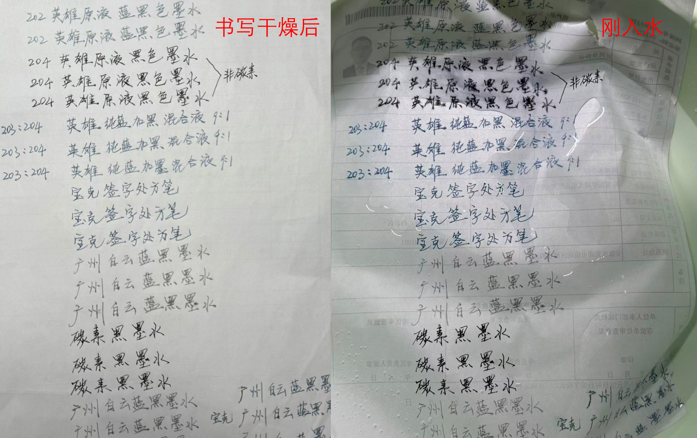
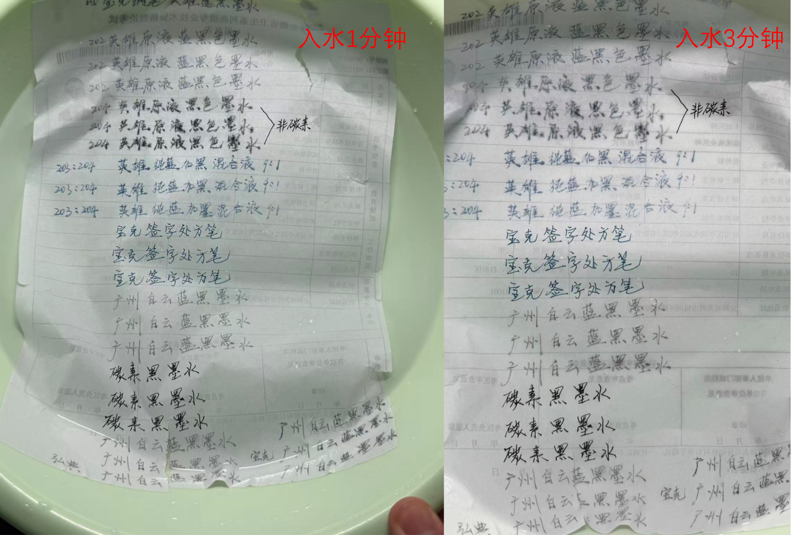

# 医生为什么要用蓝黑笔写字？

我国2010年发布的《病历书写基本规范》明确规定：“病历书写应当使用蓝黑墨水、碳素墨水”，需要复写的病历资料才可以使用蓝色或黑色油水圆珠笔。

为什么病历书写钟爱蓝黑墨水、碳素墨水呢？其他相关行业有类似的规定吗？

《事业单位登记管理档案管理办法》第十六条：

> “应当使用**碳素墨水、蓝黑墨水等符合耐久性要求的书写材料**，严禁使用纯蓝墨水、红墨水、铅笔、圆珠笔等非耐久性书写材料。”

2024财政部修订后的《会计基础工作规范》第六十条第四款明确规定：

>“登记纸质账簿要用不可擦写的蓝黑墨水或者碳素墨水书写”，不得使用圆珠笔（银行的复写账簿除外）或者铅笔书写。”

GB/T 50328—2014《建设工程文件归档规范》的表述更明确：

> 4.2.4项规定“工程文件应采用**耐久性强的书写材料，如碳素墨水、蓝黑墨水**。不得使用易褪色的书写材料，如：红色墨水、纯蓝墨水、圆珠笔、复写纸、铅笔等”

**横向比较可以看出蓝黑墨水、碳素墨水地位相当，不容易褪色，可以长期保存！

而 《医疗机构病历管理规定（2013年版）》二十九条规定：

> 门（急）诊病历由医疗机构保管的，保存时间自患者最后一次就诊之日起**不少于15年**；住院病历保存时间自患者最后一次住院出院之日起**不少于30年**。

**原来真正重要的不是什么颜色，而是字迹能不能长期保存。**

那么现在能买到的蓝黑墨水是否符合文件要求呢？ 

**是不是只要颜色是蓝黑色，就天然符合要求？**

其实并不是！

这里涉及一个很有意思的历史问题——“蓝黑墨水”这个名称，在过去的技术语境中，与今天我们在文具店看到的“蓝黑色墨水”并不完全是一回事。

传统的蓝黑墨水中，有相当重要的一类属于**铁胆墨水，也就是以鞣酸、没食子酸和铁盐为基础的鞣酸铁体系**。它**刚写出来时**可能呈蓝色或蓝紫色，随后随着空气氧化，颜色逐渐加深，最终形成深蓝黑色的字迹。传统铁胆墨水能够通过这种化学反应形成较稳定的着色物，因此历史上长期被用于正式文件、档案和重要文书的书写。而现代所谓“蓝黑墨水”，完全可能采用不同的染料和配方，无法单纯从颜色判断它的耐水、耐光和长期保存性能。

那么碳素墨水是什么颜色的呢？

你实习的时候用黑色墨水书写时是不是被老师要求重写呢？

为什么带教老师默认黑色就不符合要求呢？
可能，正是因为你的老师也是师傅教出来的缘故，师傅的师傅在行业内早已形成了用蓝黑色字迹书写习惯！
其实最经典、最稳定的还得是碳素墨水呀，想想我们的徽墨、宣纸，字画可以保存千年呢。
而现代的碳素墨水从制作工艺讲最经典的颜色就是黑色呀！
需要注意，**非碳素墨水**虽然是黑色的但不具备长期保存的能力，是**不符合要求**的。

所以：
蓝黑强调的不是蓝黑色，碳素强调的不是黑色，**真正隐藏在这条规定背后的是“墨水笔迹能否经得起时间的考验”。**

下面请看不同墨水单纯从防水性能比较笔迹的稳定性，仅供参考。

 

